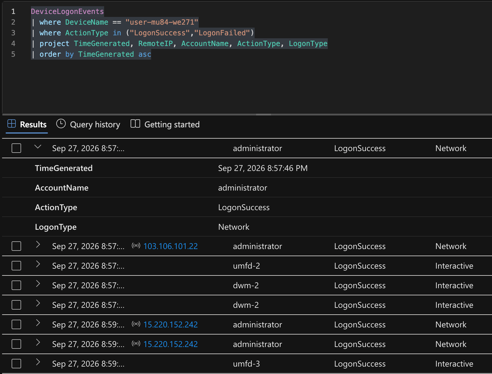
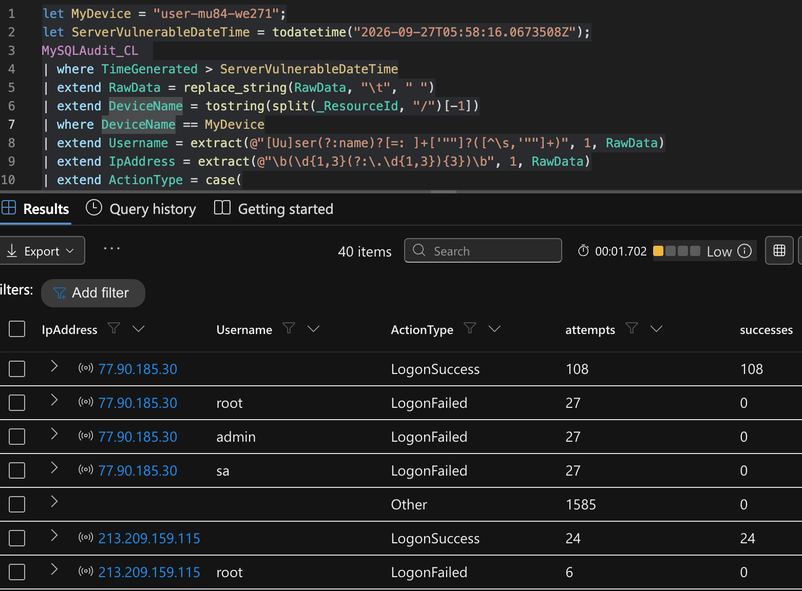
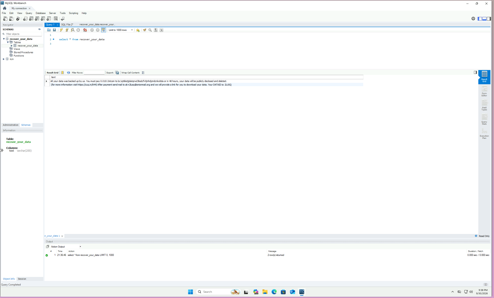
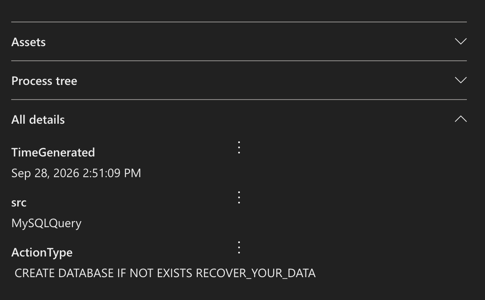
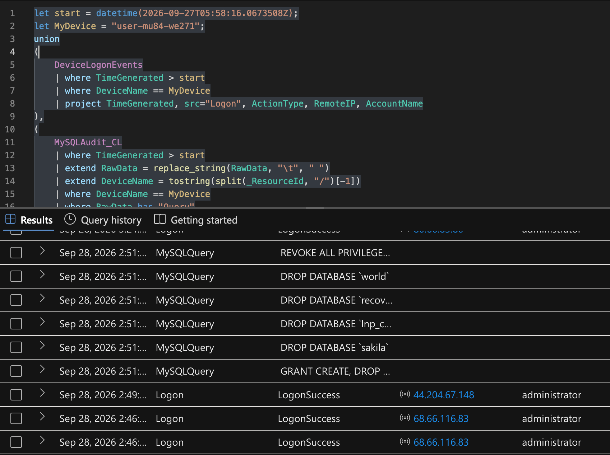

# simulated-honeypot

This is a simulated honeypot. Below is the full incident response report for the MySQL data theft and extortion attack it captured. The original document is also in this repo as [Incident Response Report MySQL Ransom.pdf](Incident%20Response%20Report%20MySQL%20Ransom.pdf).

---

# Incident Report - MySQL data theft and extortion on user-mu84-we271

An internet-exposed MySQL 8.0 instance was dumped, dropped, and left with a Bitcoin ransom note. This write-up covers what the logs show, what they do not, and what we should do next.

| Field | Value |
|---|---|
| **IR identifier** | IR-2026-0927-MYSQL-RANSOM |
| **Classification** | Unauthorized database access, data theft, destructive DROP, extortion |
| **Severity** | High |
| **Affected host** | user-mu84-we271 (Azure Windows VM, 10.3.0.30) |
| **Log window** | September 27, 2026 - September 29, 2026 |
| **Prepared from** | Defender Advanced Hunting exports and MySQL audit logs |

## Executive summary

An external actor brute-forced the password of the **administrator** account on host **user-mu84-we271** and gained access to its MySQL instance. After reconnaissance, the actor read sensitive business tables (credentials, customers, payments, orders), then dropped multiple databases and planted a **RECOVER_YOUR_DATA** ransom note demanding **0.0101 BTC**. This is a confirmed double-extortion event (exfiltration followed by destruction). Detection inputs were Defender Advanced Hunting and MySQL audit logs.

## Incident details

| Field | Value |
|---|---|
| Detection date/time | Earliest malicious activity observed: **September 27, 2026 ~9pm** (administrator account login) |
| Reporter / detection source | **Not determined** - only raw telemetry provided (Defender Advanced Hunting + MySQL audit) |
| Classification - type | Ransomware / data-extortion + destructive attack (DB drop) |
| Classification - severity | **High / Critical** (tables read and destroyed; destruction of production DB) |
| Affected host | **user-mu84-we271** |
| Affected accounts | Windows **administrator**; MySQL **root** |
| Affected data stores | MySQL DBs: **lnp_corp** (business), plus **sakila**, **world** sample DBs dropped |

### KQL query

```kql
DeviceLogonEvents
| where DeviceName == "user-mu84-we271"
| where ActionType in ("LogonSuccess","LogonFailed")
| project TimeGenerated, RemoteIP, AccountName, ActionType, LogonType
| order by TimeGenerated asc
```



## Impact

- **Confidentiality:** Breached. Sensitive **lnp_corp** tables were read just before destruction: credentials (incl. username, password, role), customers (name, email, phone, address), orders, and payments (card_brand, card_masked, card_last4, exp_month). The SQL_NO_CACHE full-column SELECT pattern shows tables were read, then destroyed, with an extortion note.
- **Integrity / Availability:** Breached. DROP DATABASE lnp_corp, world, sakila and multiple DROP TABLE statements destroyed data; REVOKE of write privileges on root@'%' further disrupted access.
- **Scope:** One host / one MySQL instance confirmed.
- **Business impact:** Loss of the **lnp_corp** production database and exposure of customer PII and payment-card metadata. Ransom demanded 0.0101 BTC with a 48-hour public-disclosure threat. Actual exfil volume and whether payment-card PAN (vs. masked) was taken: **Not determined**.

## Indicators of compromise

| Type | Value | Where seen | Role |
|---|---|---|---|
| **Bitcoin** | `bc1qt6kstjjdatqnxd3ksdcfv0jnhdjzndcnkx8zla` | INSERT, 28 Sep 14:51 | Payment |
| **Email** | `ak+2lusq@onionmail.org` | Same insert | Contact |
| **URL** | https://cuq.in/844 | Same insert | Actor page |
| **DATAID** | 2LUSQ | Same insert | Victim tag |
| **Demand** | 0.0101 BTC, 48-hour leak threat | Same insert | Extortion |
| **Schema** | RECOVER_YOUR_DATA / text; earlier `*.RECOVER_YOUR_DATA_info` | Query log | Ransom store |
| **Host** | user-mu84-we271 | All tables | Victim |

Other indicators of compromise include successful logins to **administrator** accounts from external actors, destruction of existing tables in the MySQL database, and creation of the **recover_your_data** table.

### KQL query

```kql
let MyDevice = "user-mu84-we271";
let ServerVulnerableDateTime = todatetime("2026-09-27T05:58:16.0673508Z");
MySQLAudit_CL
| where TimeGenerated > ServerVulnerableDateTime
| extend RawData = replace_string(RawData, "\t", " ")
| extend DeviceName = tostring(split(_ResourceId, "/")[-1])
| where DeviceName == MyDevice
| extend Username = extract(@"[Uu]ser(?:name)?[=: ]+['""]?([^\s,'""]+)", 1, RawData)
| extend IpAddress = extract(@"\b(\d{1,3}(?:\.\d{1,3}){3})\b", 1, RawData)
| extend ActionType = case(
    RawData has_any ("Access denied", "failed", "LogonFailed", "authentication failed"), "LogonFailed",
    RawData has_any ("LogonSuccess", "Connect", "accepted", "successful"), "LogonSuccess",
    "Other")
| summarize attempts = count(),
            successes = countif(ActionType == "LogonSuccess")
    by IpAddress, Username, ActionType
```







## Timeline

Times below are TimeGenerated on the host, which lines up with Eastern Daylight Time. This timeline covers the main attack on the host.

| Time | What happened | Source |
|---|---|---|
| **27 Sep 20:57** | First successful administrator logon from an external actor. IP was 103.106.101.22 | Logon |
| **27-28 Sep** | Several successful administrator logons from external actors | Logon |
| **28 Sep 14:46** | administrator logon from 68.66.116.83, five minutes before the database drops. Relationship not determined. | Logon |
| **28 Sep 14:49** | administrator logon from 44.208.67.148. | Logon |
| **28 Sep 14:51** | Ransom database created. Note inserted. CREATE and DROP granted to root@%. | Network, Query log |
| **28 Sep 14:51** | DROP DATABASE on recover_your_data, sakila, lnp_corp, and world. Note recreated. All privileges revoked from root@%, then SHUTDOWN granted. | Query log, MySQL auth |
| **28 Sep 17:27** | Failed root@localhost attempts, then a GUI-style look at recover_your_data. This looks like an operator, not the attacker. | Auth, Query log |
| **28 Sep 17:41** | root success from 64.89.163.179. | MySQL auth |
| **28-29 Sep** | Further root SSL successes from 77.90.185.30, 77.90.185.21, and 213.209.159.115. Queries in this extract are only SELECT @@max_allowed_packet. | Auth, Query log |

### KQL query

```kql
let start = datetime(2026-09-27T05:58:16.0673508Z);
let MyDevice = "user-mu84-we271";
union
(
    DeviceLogonEvents
    | where TimeGenerated > start
    | where DeviceName == MyDevice
    | project TimeGenerated, src="Logon", ActionType, RemoteIP, AccountName
),
(
    MySQLAudit_CL
    | where TimeGenerated > start
    | extend RawData = replace_string(RawData, "\t", " ")
    | extend DeviceName = tostring(split(_ResourceId, "/")[-1])
    | where DeviceName == MyDevice
    | where RawData has "Query"
    | extend Query = tostring(split(RawData, "Query")[1])
    | where Query has_any ("DROP", "REVOKE", "SQL_NO_CACHE", "LOCK TABLES")
    | project TimeGenerated, src="MySQLQuery", ActionType=Query, RemoteIP="", AccountName=""
)
| order by TimeGenerated desc
```



## Attack vector

Access was **credential brute-force against the internet-exposed administrator account** over RDP, followed by use of the pre-existing **root@%** MySQL account. That account had password root, full privileges, and a wildcard host, so it remained usable for remote database access after the RDP session.

## Response actions

### Completed actions

1. Isolated VM on 2026-09-30T22:06:52Z.
2. Stopped the MySQL80 service.
3. Decision made not to pay the ransom.

### Open action items

1. Take a forensic disk snapshot of host user-mu84-we271.
2. Remove root@% account and update passwords for administrator and database accounts.
3. Drop leftover RECOVER_YOUR_DATA database.
4. Enable Windows Firewall and review RDP / NLA public exposure.

### Recovery

Restore lnp_corp, and any other schema that is still needed, from a backup taken before 27 September.

## Evidence / artifacts referenced

- **DeviceLogonEvents.csv** - successful administrator network logons (IPs 103.106.101.22 and 15.220.152.242).
- **MySQLAudit_CL_-_Auth_Logs.csv** - MySQL auth successes/failures by source IP.
- **MySQLAudit_CL_-_Queries.csv** - recon, SQL_NO_CACHE reads, DROPs, ransom-note INSERTs, CREATE USER/GRANT/REVOKE.
- **DeviceProcessEvents.csv** - pwncrypt.ps1 download/exec evaluated as a potential caveat / unrelated artifact due to system account cadence rather than a confirmed component of this ransomware incident.
- **DeviceRegistryEvents.csv** - reviewed; only routine Edge/OS autolaunch entries, **no clear attacker persistence**.

## Lessons learned

1. Do not expose **RDP** or **MySQL** directly to the internet. Admin access belongs behind a **VPN** or **RD Gateway**, and MySQL should listen only on **private addresses**.
2. Do not leave blank or guessable passwords on **Administrator**, **Guest**, or **root**. Enforce **lockout** on Windows logons. The successful logons in this incident used credentials that were trivial to guess.
3. Do not create **root@%** or any wildcard-host superuser. Alert on **CREATE USER**, **GRANT ALL**, and **DROP DATABASE**.
4. Alert on mass **DROP** and ransom-note table creation, and on **SQL_NO_CACHE** bulk reads, so destruction is caught as it starts rather than after the data is gone.
5. Keep the **host firewall** enabled and enforce it by policy. An open NSG plus a disabled firewall is what made this machine reachable.
6. Alert on credential guessing and repeated **Access denied** / **failed RDP** attempts before logon success.
